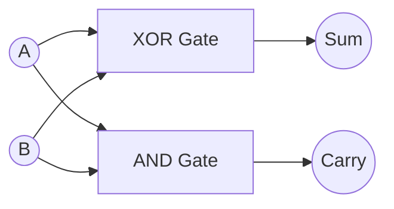

# Verilog Digital Design

<p align="center">
  
  
  
</p>

<p align="center">
  <b>Designing, Simulating, and Understanding Digital Circuits Using Verilog HDL</b>
</p>

---

## 📌 Introduction

Welcome to **Verilog-Digital-Design**!

This repository contains Verilog HDL implementations of fundamental digital circuits, starting from basic logic gates and combinational circuits to sequential circuits and advanced digital systems.

The main objective is to understand how digital circuits can be described using Verilog, verified through simulation, and prepared for hardware implementation.

## 🔹 What is Verilog?

**Verilog** is a Hardware Description Language (HDL) used to describe the structure and behavior of digital electronic circuits.

Unlike programming languages such as C or Python, which describe instructions executed by a processor, Verilog describes hardware components and their connections.

Using Verilog, we can design:

- Logic gates and Boolean expressions
- Combinational circuits
- Sequential circuits
- Finite State Machines (FSMs)
- Registers, counters, and memories
- Processor datapaths and control units
- Complex digital systems

Verilog is widely used in digital hardware design, FPGA development, and ASIC design.

## 🔹 Why is Verilog Needed?

Modern digital systems contain millions or billions of transistors. Designing such systems manually using individual logic gates is difficult and time-consuming.

Verilog provides an efficient way to describe, simulate, verify, and synthesize digital hardware.

### Advantages of Verilog

- **Hardware Abstraction:** Describe circuits at different levels of abstraction.
- **Simulation:** Test circuit functionality before hardware implementation.
- **Reusability:** Create modules that can be reused in larger designs.
- **Scalability:** Design complex systems using smaller modules.
- **Synthesis:** Convert RTL descriptions into gate-level hardware.
- **Verification:** Identify design errors using testbenches.
- **FPGA and ASIC Development:** Implement designs on real hardware.


### Design Steps

1. **Specification:** Understand the required functionality.
2. **Logic Design:** Develop Boolean equations, truth tables, or state diagrams.
3. **RTL Coding:** Describe the circuit using Verilog.
4. **Testbench Development:** Generate inputs and check outputs.
5. **Simulation:** Verify the design using a simulator.
6. **Synthesis:** Convert RTL into a hardware netlist.
7. **Implementation:** Map the design to an FPGA or ASIC.
8. **Testing:** Verify the circuit on actual hardware.

## 🔹 How to Implement a Circuit Using Verilog

Let's understand the complete process using a **Half Adder**.

### 1. Understand the Circuit

A Half Adder adds two 1-bit binary inputs and produces a Sum and Carry.

| A | B | Sum | Carry |
|---|---|---|---|
| 0 | 0 | 0 | 0 |
| 0 | 1 | 1 | 0 |
| 1 | 0 | 1 | 0 |
| 1 | 1 | 0 | 1 |

**Boolean Expressions:**

$$
Sum = A \oplus B
$$

$$
Carry = A \cdot B
$$
### 2. Half Adder Circuit Diagram

A Half Adder consists of an XOR gate for the Sum output and an AND gate for the Carry output.



### 3. Write the Verilog RTL Code

Create a file named `half_adder.v`.

```verilog
module half_adder (
    input  wire a,
    input  wire b,
    output wire sum,
    output wire carry
);

    assign sum   = a ^ b;
    assign carry = a & b;

endmodule
```


**Explanation:**

- `module` defines a hardware component.
- `input` declares input signals.
- `output` declares output signals.
- `assign` describes continuous combinational logic.
- `endmodule` marks the end of the module.

### 4. Write a Testbench

A testbench applies input combinations and verifies the circuit through simulation.

Create `half_adder_tb.v`.

```verilog
`timescale 1ns/1ps

module half_adder_tb;

    reg a, b;
    wire sum, carry;

    half_adder uut (
        .a(a),
        .b(b),
        .sum(sum),
        .carry(carry)
    );

    initial begin
        $monitor("A=%b B=%b Sum=%b Carry=%b",
                  a, b, sum, carry);

        a = 0; b = 0; #10;
        a = 0; b = 1; #10;
        a = 1; b = 0; #10;
        a = 1; b = 1; #10;

        $finish;
    end

endmodule
```

### 5. Simulate the Design

Using Icarus Verilog:

```bash
iverilog -o half_adder_sim half_adder.v half_adder_tb.v
vvp half_adder_sim
```

**Expected Output:**

```text
A=0 B=0 Sum=0 Carry=0
A=0 B=1 Sum=1 Carry=0
A=1 B=0 Sum=1 Carry=0
A=1 B=1 Sum=0 Carry=1
```

The simulation results should match the truth table.

### 6. Synthesize the Circuit

After successful simulation, the Verilog RTL can be synthesized using tools such as:

- Xilinx Vivado
- Intel Quartus Prime
- Yosys
- Synopsys Design Compiler

Synthesis converts the RTL description into a gate-level netlist representing the hardware implementation.

## 🔹 Types of Verilog Modeling

| Modeling Style | Description |
|---|---|
| Gate-Level | Describes circuits using logic gate primitives |
| Dataflow | Uses Boolean expressions and `assign` statements |
| Behavioral | Describes functionality using procedural blocks |
| Structural | Connects multiple modules to form larger circuits |

**Dataflow Example:**

```verilog
assign y = (a & b) | c;
```

**Behavioral Example:**

```verilog
always @(*) begin
    y = (a & b) | c;
end
```

## 🔹 Repository Contents

This repository covers digital design concepts through practical Verilog implementations.

```text
Verilog-Digital-Design/
│
├── 01_half_adder/
├── 02_full_adder/
├── 03_multiplexer/
├── 04_demultiplexer/
├── 05_decoder/
├── 06_encoder/
├── 07_comparator/
├── 08_ripple_carry_adder/
├── 09_flip_flops/
├── 10_registers/
├── 11_counters/
├── 12_fsm/
│
└── README.md
```

*Update this structure according to the actual folders in the repository.*

## 🔹 Tools Used

| Tool | Purpose |
|---|---|
| Verilog HDL | Hardware description |
| Icarus Verilog | RTL simulation |
| GTKWave | Waveform visualization |
| EDA Playground | Online Verilog simulation |
| Xilinx Vivado | FPGA design and implementation |
| Yosys | Open-source synthesis |

## 🔹 Learning Objectives

By working through this repository, you will learn to:

- Understand the fundamentals of digital logic design.
- Write Verilog RTL code.
- Implement combinational and sequential circuits.
- Develop testbenches for functional verification.
- Analyze simulation waveforms.
- Understand the RTL-to-hardware design flow.
- Build a foundation for FPGA and ASIC design.

## 🔹 References

- [Verilog HDL](https://en.wikipedia.org/wiki/Verilog)
- [IEEE Verilog Standard](https://standards.ieee.org/standard/1364-2005.html)
- [EDA Playground](https://www.edaplayground.com/)
- [Icarus Verilog](https://github.com/steveicarus/iverilog)
- [GTKWave](https://gtkwave.sourceforge.net/)
- [Yosys Open Source Synthesis](https://yosyshq.net/yosys/)

## 👨‍💻 Author

**Nirmal Mandal**

B.Tech in Computer Science and Engineering  
M.Tech in System on Chip Design — IIT Palakkad

- GitHub: [@garbage38](https://github.com/garbage38)
- Repository: [Verilog-Digital-Design](https://github.com/garbage38/Verilog-Digital-Design)

---

<p align="center">
  <b>Learn Digital Design • Write RTL • Simulate • Synthesize • Build Hardware</b>
</p>
