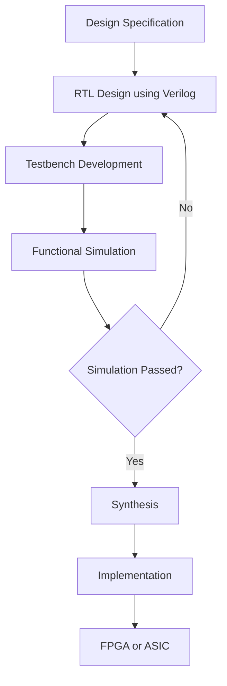
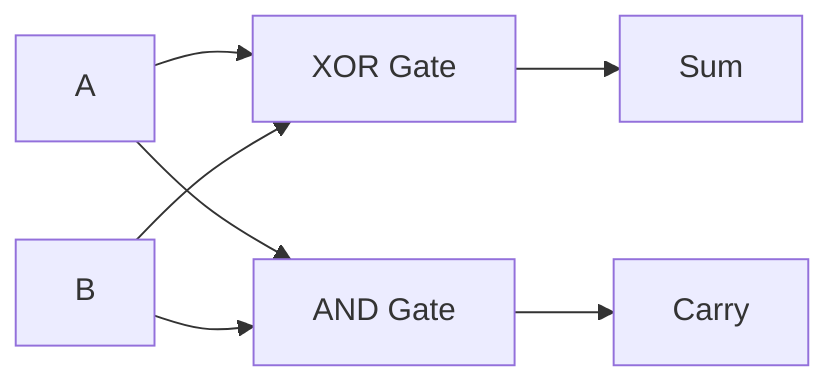

# Verilog Digital Design

A collection of digital circuits designed and implemented using **Verilog HDL**. This repository contains RTL designs, testbenches, simulation results, and examples for learning digital logic design and hardware description languages.

## What is Verilog?

**Verilog** is a Hardware Description Language (HDL) used to describe, simulate, and implement digital electronic systems.

Unlike software programming languages, Verilog describes hardware components and their behavior. It is used to design digital circuits such as logic gates, multiplexers, adders, registers, counters, finite state machines, and processors.

## Why Verilog?

Verilog is widely used in digital hardware design because it allows us to:

- Describe digital circuits using a hardware description language.
- Simulate and verify circuit behavior before implementation.
- Design combinational and sequential logic.
- Implement digital systems on FPGA and ASIC platforms.
- Create reusable and modular hardware designs.
- Verify designs using testbenches.

## Digital Design Flow

The typical digital design flow using Verilog is:



## Implementing a Digital Circuit Using Verilog

A digital circuit can be implemented using the following steps:

1. Understand the circuit specification.
2. Identify the inputs and outputs.
3. Write the Verilog RTL code.
4. Create a testbench to verify the design.
5. Simulate the design using a Verilog simulator.
6. Check the simulation results.
7. Synthesize and implement the design on hardware, if required.

## Example: Half Adder

A **Half Adder** is a combinational circuit that adds two single-bit binary inputs.

### Truth Table

| A | B | Sum | Carry |
|---|---|-----|-------|
| 0 | 0 |  0  |   0   |
| 0 | 1 |  1  |   0   |
| 1 | 0 |  1  |   0   |
| 1 | 1 |  0  |   1   |

### Logic Diagram



### Verilog RTL Code

```verilog
module half_adder (
    input  wire a,
    input  wire b,
    output wire sum,
    output wire carry
);

    assign sum   = a ^ b;
    assign carry = a & b;

endmodule
```

### Testbench

```verilog
`timescale 1ns/1ps

module half_adder_tb;

    reg a, b;
    wire sum, carry;

    half_adder uut (
        .a(a),
        .b(b),
        .sum(sum),
        .carry(carry)
    );

    initial begin
        $dumpfile("half_adder.vcd");
        $dumpvars(0, half_adder_tb);

        a = 0; b = 0; #10;
        a = 0; b = 1; #10;
        a = 1; b = 0; #10;
        a = 1; b = 1; #10;

        $finish;
    end

endmodule
```

### Simulation

Using Icarus Verilog:

```bash
iverilog -o half_adder_sim half_adder.v half_adder_tb.v
vvp half_adder_sim
```

To view the waveform:

```bash
gtkwave half_adder.vcd
```

## Repository Structure

```text
Verilog-Digital-Design/
│
├── 01_/
├── 02_/
├── 03_/
├── 04_/
├── 05_/
├── 06_/
├── 07_/
├── 08_/
├── 09_/
├── 10_/
├── 11_/
├── 12_/
│
└── README.md
```

Each numbered folder contains the corresponding Verilog design, testbench, and related files.

## Tools Used

- **Verilog HDL** — Hardware description
- **Icarus Verilog** — RTL simulation
- **GTKWave** — Waveform visualization
- **EDA Playground** — Online Verilog simulation
- **Git and GitHub** — Version control and project hosting

## Learning Objectives

- Understand combinational and sequential digital circuits.
- Develop RTL designs using Verilog.
- Write testbenches for functional verification.
- Simulate and analyze digital circuit behavior.
- Build a foundation for FPGA and ASIC design.

## References

- [HDLBits](https://hdlbits.01xz.net/wiki/Main_Page)
- [IEEE Verilog Standard](https://standards.ieee.org/standard/1364-2005.html)
- [Icarus Verilog](https://iverilog.fandom.com/wiki/Main_Page)
- [GTKWave](https://gtkwave.sourceforge.net/)

---

**Author:** Nirmal Mandal

**Repository:** [Verilog-Digital-Design](https://github.com/garbage38/Verilog-Digital-Design)
